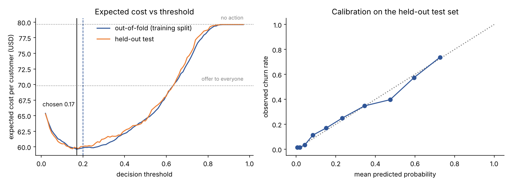

# Model card: telecom churn classifier

| | |
|---|---|
| **Version** | `churn-logistic-16320c9c` (name = family + first 8 hex chars of the training-data SHA-256) |
| **Type** | scikit-learn `Pipeline`: cleaning → impute → one-hot / standardise → logistic regression (C = 10) |
| **Task** | Predict the probability that a customer churns, so the CRM can decide whom to offer a retention deal |
| **Trained** | see `artifacts/<version>/metadata.json` (also holds data hash, model hash, library versions, metrics, cost model) |
| **Owner / contact** | _fill in before production use_ |

## Intended use
Ranking and flagging current subscribers for a retention offer, called from a CRM through the API in this repository.
The decision is probability ≥ **0.17**, a threshold derived from a cost model (below), not the default 0.5.

**Not intended for:** decisions about service, pricing or credit for an individual; any use on a population that differs from the training data (other countries, prepaid-only, business customers) without re-validation.

## Data
* IBM's public "Telco Customer Churn" sample file: 7,043 customers, 19 model inputs, 26.5 % churners.
  SHA-256 `16320c9c1ec7…e3055e91`.
* Known quality problems, all handled inside the pipeline: `TotalCharges` is stored as text and is blank for 11 customers with tenure 0 (median-imputed); no duplicate IDs; categories are consistent.
* Split: stratified 80/20 (5,634 train / 1,409 test, seed 42). The test set was used **once**, after model and threshold were fixed.
* **Caveat: this is a sample dataset published by IBM for demonstrations; it is not a record of real customers of any specific operator.** Every number below shows that the engineering works and what the method yields on this file. None of them predicts performance on your customers.

## Training procedure
1. Two model families were tuned with 5-fold stratified cross-validated grid search on ROC-AUC (training split only): logistic regression (C over nine values, 0.01–100) and histogram gradient boosting (24 combinations of learning rate, depth, leaf size, L2).
2. **Selection:** CV AUC was 0.8463 ± 0.0127 (logistic) vs 0.8496 ± 0.0108 (boosting). The 0.0033 gap is smaller than one standard error of the logistic score (0.0057), so the simpler, faster and more interpretable logistic model was chosen (one-standard-error rule).
3. **Threshold:** chosen on out-of-fold predictions from the training split, using the cost model below.
4. Evaluated once on the held-out test set; confidence intervals are 1,000-sample bootstrap percentile intervals.

## Performance (held-out test set, n = 1,409)
| Metric | Value |
|---|---|
| ROC-AUC | **0.841** (95 % CI 0.818 – 0.862) |
| Brier score | 0.139 |
| At threshold 0.17 | recall **0.898**, precision 0.450, F1 0.600 (TP 336, FN 38, FP 411, TN 624) |
| At threshold 0.50 (for comparison) | recall 0.559, precision 0.657, F1 0.604 (TP 209, FN 165, FP 109, TN 926) |

F1 barely changes between the two thresholds, which is why F1 is the wrong guide here: the two kinds of error cost different amounts.

Calibration (right panel below) is close to the diagonal, which matters because the threshold logic assumes the probabilities mean what they say.

## Threshold choice and why
**Cost model** (assumptions, in `churn_core/costs.py`; replace with your finance team's numbers):

| Symbol | Meaning | Value used |
|---|---|---|
| L | margin lost when a customer churns | $300 |
| O | cost of one retention offer, paid whether or not the customer would have left | $30 |
| s | share of would-be churners an offer keeps | 50 % |

Offering costs `O + p(1-s)L`; doing nothing costs `pL`. Offering is cheaper when **p > O / (s·L) = 0.20**.
That is an analytic answer assuming calibrated scores. Because real scores are only approximately calibrated, training also scans every threshold from 0.02 to 0.97 on out-of-fold predictions and takes the cheapest: **0.17**.

Expected cost per customer on the test set:

| Policy | Cost | vs. doing nothing |
|---|---|---|
| Do nothing | $79.63 | – |
| Offer to everyone | $69.82 | −12 % |
| Threshold 0.50 | $64.15 | −19 % |
| **Threshold 0.17 (chosen)** | **$59.77** | **−25 %** |

Why this is a sound choice and not a lucky one:
* The out-of-fold curve and the test curve have the same shape and the same minimum region.
* The curve is **flat** between about 0.13 and 0.25 (test cost $60.0–60.3). Small errors in the threshold, or in the cost assumptions, cost cents, not dollars.
* The analytic (0.20) and empirical (0.17) answers agree.
* Re-deriving the threshold under other plausible assumptions moves it in the expected direction (cheaper offers or higher customer value → lower threshold):

| L | O | s | analytic | empirical (OOF) | test cost / customer | do nothing |
|---|---|---|---|---|---|---|
| 300 | 30 | 0.5 | 0.20 | 0.17 | $59.77 | $79.63 |
| 300 | 15 | 0.5 | 0.10 | 0.13 | $51.41 | $79.63 |
| 300 | 60 | 0.5 | 0.40 | 0.43 | $71.86 | $79.63 |
| 600 | 30 | 0.5 | 0.10 | 0.13 | $102.82 | $159.26 |
| 150 | 30 | 0.5 | 0.40 | 0.43 | $35.93 | $39.82 |
| 300 | 30 | 0.3 | 0.33 | 0.35 | $73.01 | $79.63 |
| 300 | 30 | 0.8 | 0.125 | 0.13 | $37.92 | $79.63 |

**What the threshold costs you:** at 0.17, **53 % of customers are flagged** and only 45 % of flagged customers are real churners. That is the right trade only if an offer really is cheap relative to a lost customer. If the offer budget is capped, raise the threshold or rank by probability and take the top *k*.
The real value of `s` (offer success) is the least certain input and the one with the largest effect (rows 6–7); measure it with a controlled retention experiment (see `docs/RETRAINING.md`).

## Performance by group (test set; `scripts/subgroup_report.py`)
| Group | n | churn rate | AUC | recall @0.17 | flagged |
|---|---|---|---|---|---|
| Female / Male | 687 / 722 | 28.1 % / 25.1 % | 0.836 / 0.847 | 0.88 / 0.92 | 53 % / 53 % |
| Not senior / Senior | 1,187 / 222 | 23.3 % / 44.1 % | 0.842 / 0.781 | 0.87 / 0.98 | 48 % / 80 % |
| Month-to-month | 773 | 42.6 % | 0.742 | 0.96 | 87 % |
| One year | 300 | 12.0 % | 0.738 | 0.53 | 25 % |
| Two year | 336 | 2.7 % | 0.759 | 0.00 (9 churners) | 1 % |
| Tenure 0–12 / 13–24 / 25–48 / 49+ months | 449 / 206 / 304 / 450 | 47.9 / 29.1 / 21.1 / 7.8 % | 0.745 / 0.813 / 0.798 / 0.831 | 0.96 / 0.97 / 0.80 / 0.57 | 87 / 71 / 45 / 16 % |

Reading it honestly:
* Within the contract and tenure groups, AUC is about 0.74–0.83, lower than the overall 0.84. A good part of the overall ranking power comes from contract type and tenure; inside a group the model is a weaker discriminator.
* Long-contract customers who do churn are mostly missed (recall 0.53 for one-year, 0 of 9 for two-year). Retention offers aimed at them would need a different model or rule.
* Senior citizens are flagged at 80 % against 48 %. Their churn rate really is higher (44 %), but the model uses `SeniorCitizen` and `gender` as inputs. **Whether using these attributes is acceptable is a legal and policy question for the operator**; the simplest mitigation is to drop both columns (the pipeline's column list is one constant in `churn_core/features.py`) and re-run the group report. This was not done here and no fairness audit beyond the table above has been carried out.

## Limitations
* Sample dataset, a single snapshot and a single random split (no time-based split, so effects of seasonality, pricing changes and product launches are untested).
* Cost figures are illustrative.
* Only 19 features; no usage, billing-dispute, support-contact or competitor-offer data, which usually matter in real churn work.
* Boosting was not better by more than noise on this file; with richer data that may change.
* The artefact is a pickle (`joblib`). It is loaded only after its SHA-256 matches `metadata.json`, but that is an integrity check, not a signature: keep artefacts in a trusted store.

## Monitoring
`POST /drift` returns the Population Stability Index of recent inputs against the training inputs, per feature (decile bins for numbers, category shares plus an "unseen" bin for categories). Flag at PSI > 0.2 (standard rule of thumb: < 0.1 stable, 0.1–0.2 moderate). On 200 rows resampled from the training file the largest PSI was 0.026; the same rows with +$35 monthly charges and all contracts month-to-month flagged `MonthlyCharges` (3.06) and `Contract` (3.74). Input drift is only a proxy: the real health check is comparing predictions with outcomes once labels arrive.
